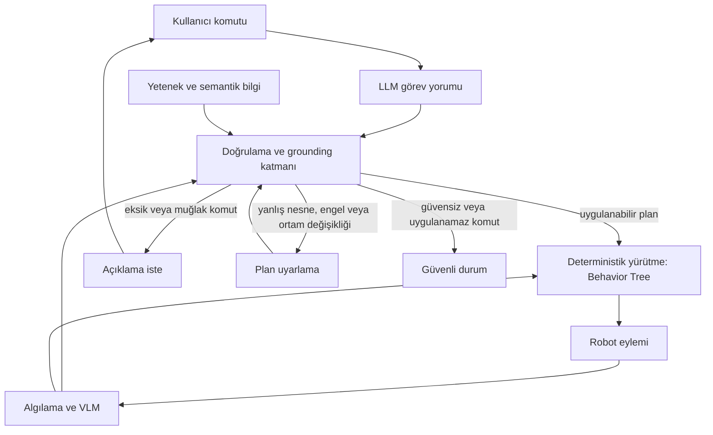

# Sistem mimarisi (taslak)

Bu belge bir taslaktır. Katman sınırları, arayüzler ve kontrol akışı grup içinde değişebilir. Uygulama kodu henüz yazılmamıştır.

Amaç, dil modelinin görev yorumunu, doğrulama ve grounding katmanını, ve deterministik yürütmeyi (Behavior Tree) birbirinden ayırmaktır. Algılama ile yetenek/semantik bilgi doğrulamaya girdi sağlar. Eksik veya muğlak komutta açıklama istenir. Yanlış nesne, engellenmiş hedef, ortam değişikliği veya güvensiz/uygulanamaz komutta plan uyarlanır ya da güvenli duruma geçilir.

## Katmanlar (taslak)

- **LLM görev yorumu:** Doğal dil komutunu aday bir görev tanımına ve plan adımlarına çevirir. Bu çıktı tek başına yürütülmez.
- **Doğrulama ve grounding:** Aday planı görsel kanıt, semantik bilgi ve fiziksel yeteneklerle karşılaştırır. Çelişki, eksik bilgi veya güvenlik ihlali varsa açıklama, uyarlama veya güvenli durum yollarından birini seçer.
- **Algılama ve VLM:** Ortamdaki nesne, konum ve ilişki kanıtını üretir.
- **Yetenek ve semantik bilgi:** Robotun yapabileceği eylemleri ve sahne bilgisini tutar.
- **Deterministik yürütme:** Onaylanan planı Behavior Tree olarak çalıştırır. Düşük seviye kontrol dil modeline bırakılmaz.

Bu diyagram uygulama değil, tasarım taslağıdır.
